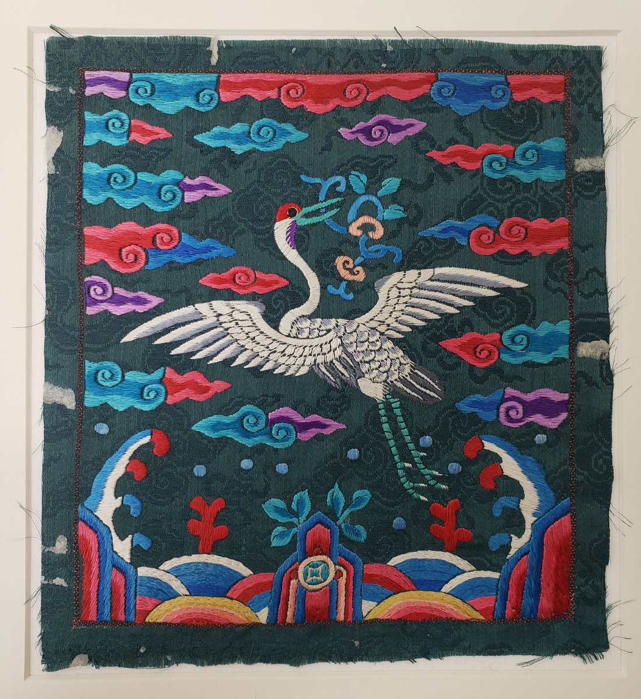

> 이미지는 이용허락을 확인한 것만 싣는다. 실물 사진은 CC 라이선스 사진을 쓰고 출처와 라이선스를 적는다. 흉배 이미지는 소장처의 이용허락(공공누리, CC0 등)을 확인한 뒤 싣는다. 확인 전인 칸은 "이미지 준비 중"으로 둔다.

## 학

| 실물 | 흉배 |
|---|---|
| *이미지 준비 중* |  메트로폴리탄 미술관 소장 |

## 백한

| 실물 | 흉배 |
|---|---|
| *이미지 준비 중* | *이미지 준비 중* |

## 꿩

| 실물 | 흉배 |
|---|---|
| *이미지 준비 중* | *이미지 준비 중* |

## 기러기

| 실물 | 흉배 |
|---|---|
| *이미지 준비 중* | *이미지 준비 중* |

## 노사 (鷺鷥)

해오라기 · 백로.

| 실물 | 흉배 |
|---|---|
| *이미지 준비 중* (해오라기) | *이미지 준비 중* (노사문 흉배, 1425–1475) |
| *이미지 준비 중* (백로) | |

## 공작

| 실물 | 흉배 |
|---|---|
| *이미지 준비 중* | *이미지 준비 중* (청) |

## 계칙 (鸂鶒)

비오리 · 바다비오리.

| 실물 | 흉배 |
|---|---|
| *이미지 준비 중* (비오리) | *이미지 준비 중* (청, 칠품 문관) |
| *이미지 준비 중* (바다비오리) | *이미지 준비 중* (청, 칠품 문관) |

## 이미지 넣는 법

1. 이미지를 가로 1200px 안팎으로 줄여 `hyungbae/manual/images/` 폴더에 올린다. 파일 이름은 영문으로 쓴다 (예: `crane-photo.jpg`).
2. 위 표의 *이미지 준비 중*을 ` 출처 · 라이선스`로 바꾼다.
3. 흉배 이미지는 소장처 유물 페이지로 링크를 건다: ``
